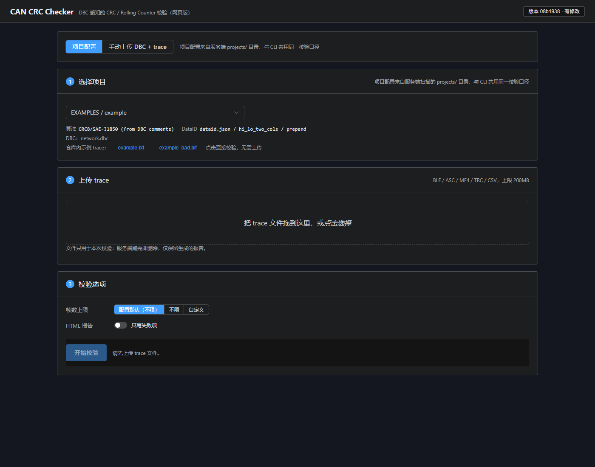
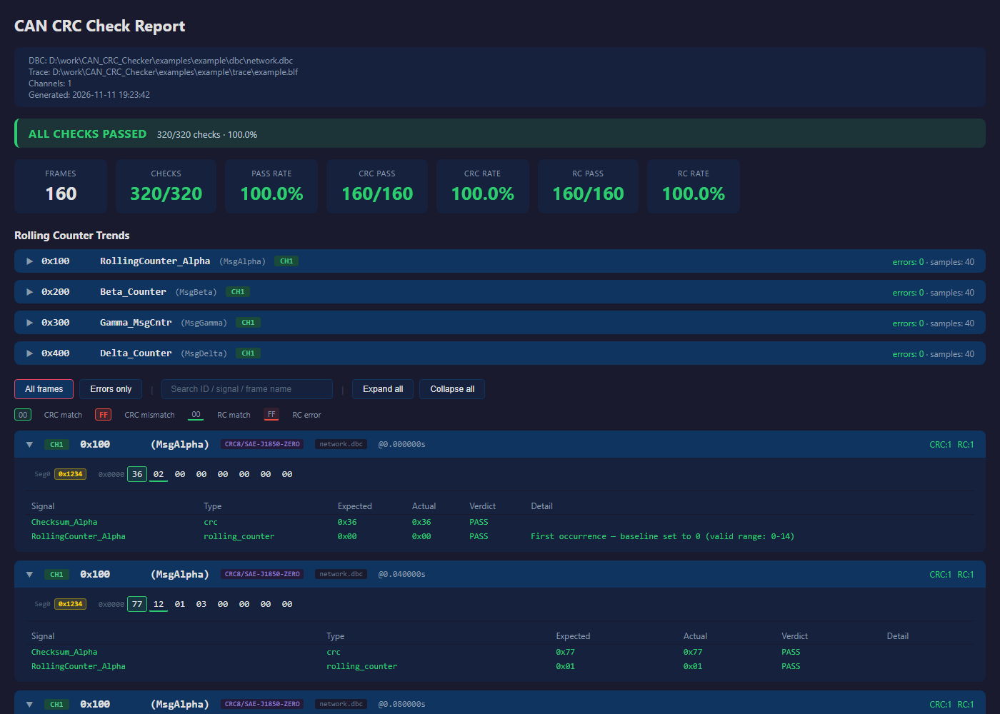

<div align="center">

# CAN CRC Checker

DBC-aware CAN bus CRC / rolling-counter verification for BLF, ASC, MF4 and TRC traces.

[](https://opensource.org/licenses/MIT)
[](https://www.python.org/)
[](https://github.com/zhaojiale2021/CAN_CRC_Checker/actions/workflows/ci.yml)

[English](./README.md) | [🌍 中文](./docs/zh-CN/README.md)

</div>

---

| Web UI | Self-contained HTML report |
| --- | --- |
|  |  |

---

Point it at a DBC and a captured trace. It finds the checksum and rolling-counter
signals by name, computes the expected values with the configured algorithm, and
reports every mismatch with a self-contained HTML report. No vehicle-specific
code: signal-name patterns and DataID workbook layouts are configuration files.

The repository ships **only synthetic example data**.

## 🚀 30-second start

```bash
git clone https://github.com/zhaojiale2021/CAN_CRC_Checker.git
cd CAN_CRC_Checker
pip install -r requirements.txt

# Run the bundled example (CLI; no packaging step, no .exe)
python -m cli.main run -c examples/example/config.json -v

# Optional: install the `crc-check` command
pip install -e .
crc-check run -c examples/example/config.json -v
crc-check presets
crc-check inspect examples/example/dbc/network.dbc
```

Expected output: 160 frames, 320 checks, 100 % pass.

```bash
# Deliberately broken example → failures + RC error trends
python -m cli.main run -c examples/example/config_bad.json -v
```

Use it as a gate: `--fail-on-failure` exits 1 on any failed check, and
`--min-pass-rate 99.5` exits 1 below the threshold (both also work on
`crc-check verify`).

```bash
crc-check run -c examples/example/config.json --fail-on-failure
```

MF4/MDF traces need python-can's optional reader; `requirements.txt` already
installs it. For a bare `pip install -e .`, add it with
`pip install "python-can[mf4]"` (or `pip install -e ".[mf4]"`).

## 🌐 Web version

```bash
./run_web.sh 8000          # Windows: run_web.bat 8000
# http://127.0.0.1:8000
```

Two ways to run: pick a **project id**, or switch to **manual mode** and upload
DBC file(s) + a trace (plus an optional DataID file), then fill in the config
options (algorithm, range, DataID layout, filters) on the page. A project's
bundled sample traces are one click away — no download-then-upload detour.
The browser only sends project ids or uploaded files; paths stay server-side.
Projects are scanned from `projects/` (or `examples/` when `projects/` does not
exist; override with `CRC_CHECKER_PROJECTS_DIR`). The Vue frontend is committed
as `frontend/dist`, so a deployment machine needs no Node. The launcher binds to
`127.0.0.1` by default; set `CRC_WEB_HOST` or pass a host argument to opt into
LAN binding. The web server has no authentication, so network exposure should be
behind an authenticated reverse proxy or equivalent access controls. See
[docs/web-api.md](docs/web-api.md).

## 🌟 What you get

| When you need… | What it does |
| --- | --- |
| **Find protection signals automatically** | Prefix (`Checksum_*`, `CRC_*`) and suffix (`*_CRC`, `*_Counter`) naming, indexed E2E instances, sensor bus markers, block-counter exclusion — all driven by YAML regexes |
| **Verify E2E profiles** | Profile 5 (CRC16/CCITT, DataID append, byte swap) and Profile 1/1A (CRC8/SAE-J1850-ZERO, DataID prepend, 4-bit counter) |
| **Non-CRC checksums** | SUM8, SUM8/XOR-FF, XOR8/SEED, selected per message from DBC comments |
| **Many trace formats** | BLF, ASC, MF4, TRC, CSV/LOG via python-can (MF4 via the `python-can[mf4]` extra) |
| **Big traces** | Streaming verification, cached CRC engines, decimated RC trend charts, report size guard |
| **CI gating** | `--fail-on-failure` / `--min-pass-rate`; the frame cap is never silent |
| **DataID tables** | `.xlsx`, legacy `.xls` and preprocessed JSON; named column layouts from YAML |
| **Reproducible results** | CLI and web share one runner (`crc_checker/verify/runner.py`) |

## 🧮 Supported algorithms

Verified with real data means the algorithm reproduced expected values on
captured CAN traces during development. Everything else is implemented and
unit-tested against known-answer vectors, but **not verified with real data** —
`crc-check presets` prints the same status.

| Preset | Use | Status |
| --- | --- | --- |
| `CRC16/CCITT` | AUTOSAR E2E Profile 5 | ✅ verified with real data |
| `CRC8/SAE-J1850-ZERO` | AUTOSAR E2E Profile 1 / 1A | ✅ verified with real data |
| `CRC8/SAE-J1850` | DBC-comment checksums | ✅ verified with real data |
| `SUM8/XOR-FF` | sum of bytes `& 0xFF`, then `XOR 0xFF` | ✅ verified with real data |
| `XOR8/SEED` | byte-wise XOR with a constant seed | ✅ verified with real data |
| `SUM8` | plain additive sum `& 0xFF` | ✅ verified (wider variants unverified) |
| `CRC8/AUTOSAR`, `CRC8/H2F`, `CRC16/ARC`, `CRC16/MODBUS`, `CRC32/AUTOSAR`, `CRC32/ETHERNET`, `XOR8` | — | ⚠️ not verified with real data |

Details and promotion checklist: [docs/supported-algorithms.md](docs/supported-algorithms.md).

## 🧩 Extending without code changes

**New signal naming** — add a regex to
[`crc_checker/data/patterns.yaml`](crc_checker/data/patterns.yaml):

```yaml
checksum:
  prefix: ['(?i)^(checksum|check_sum|crc|e2e_crc)']
  suffix: ['(?i)(_crc|_checksum|_chks)([0-9_]*)$']
rolling_counter:
  prefix: ['(?i)^(rolling.?counter|rc_|alive.?counter)']
  suffix: ['(?i)(_counter|_cntr|_msgcntr)([0-9_]*)$']
  exclude: ['(?i)block_?counter']
```

Or point `signals.patterns_file` at your own YAML, or use
`signals.checksum_patterns` / `signals.rc_patterns` inline.

**New DataID workbook layout** — add a named mapping to
[`crc_checker/data/dataid_mappings.yaml`](crc_checker/data/dataid_mappings.yaml),
then select it with `dataid.mapping`. Use `dataid.mapping_file` for a separate
file. Built-in names: `hi_lo_two_cols`, `single_16bit`, `generic_abc`,
`simple_8bit`, `description_regex`.

**New project** — put `config.json` (+ DBC / DataID / trace) under `projects/`.

## ⚙️ Configuration

A run is a JSON file (`crc-check gen-config` writes an annotated example). The
main sections:

| Section | Field | Description |
| --- | --- | --- |
| top level | `dbc` / `dbcs` | One DBC path, or a list of files/directories |
| | `dbc_merge` | Merge several DBCs into one map instead of selecting per trace channel |
| `crc` | `preset` | Preset name, or `custom` for inline parameters |
| | `byte_swap` | Swap computed CRC bytes (Profile 5) |
| | `auto_classify` | Pick the algorithm per message from DBC comments |
| | `profile_by_width` | 2-byte CRC → Profile 5, 1-byte → Profile 1 |
| | `profiles` | Per-profile overrides (algorithm, DataID layout, range, counter max) |
| | `range_overrides` / `skip` | Per-message range / unverified signals |
| `range` | `mode` | `exclude_crc` / `full_payload` / `custom_range` |
| | `start_byte` / `end_byte` | Range for `custom_range` (`-1` = end of payload) |
| `dataid` | `json` / `xlsx` | Preprocessed JSON (fast) or Excel workbook |
| | `mapping` / `mapping_file` | DataID column layout |
| | `position` / `byte_order` / `default` | `prepend`/`append`, `lo_hi`/`hi_lo`, fallback DataID |
| `signals` | `patterns_file` | Custom signal-name YAML |
| | `checksum_pattern(s)` / `rc_pattern(s)` | Regex overrides |
| `filter` | `frame_ids` / `max_frames` | CAN ID filter; frame cap (`0` = unlimited, default 6000) |
| `rc` | `max_valid` | Max valid counter value (default `2^bits - 1`) |
| `output` | `format` / `file` / `only_failures` | `table` or `html`, path, failures-only view |
| | `max_report_sections` | Frame-section cap (default 30 000, 0 = unlimited) |

Full schema: `crc_checker/config.py` (`CONFIG_SCHEMA_DOC`).

## 📁 Repository layout

```
crc_checker/            Core package
  crc/                  CRC engine, presets, E2E profiles, comment classifier
  dbc/                  DBC parser + signal resolver
  dataid/               DataID Excel/JSON parser
  trace/                Trace reader (BLF/ASC/MF4/TRC/CSV)
  protect/              CRC and rolling-counter verifiers
  verify/               Verification orchestration (shared by CLI and web)
  report/               Self-contained HTML report + RC trend charts
  data/                 Shipped pattern and DataID-mapping defaults
cli/                    Click CLI (python -m cli.main)
webapp/                 FastAPI backend
frontend/               Vue 3 + Element Plus (dist committed)
examples/               Synthetic example project + generator
tests/                  pytest suite
```

## 🧪 Development

```bash
pytest --tb=short --cov=crc_checker --cov=cli --cov=webapp \
  --cov-report=term --cov-fail-under=80          # CI backend test command
pylint $(git ls-files '*.py')                     # must stay 10.00/10
cd frontend && npm run lint                       # eslint + prettier check
cd frontend && npm test                           # node --test (pure logic)
cd frontend && npm run test:component             # vitest (@vue/test-utils)
cd frontend && npm install && npm run build       # rebuild committed dist
python examples/generate_example.py               # regenerate the example
```

CI runs pylint and coverage-gated pytest on Python 3.9, 3.11 and 3.13, plus a
Windows pytest job and frontend lint/tests/build freshness checks. The pre-push
hook runs pylint and the same 80%-coverage backend pytest command using Python
3.11 when `uv` is installed; otherwise it uses the active Python environment.
It does not replace the full CI matrix or frontend checks.

## 🤝 Contributing

Issues and pull requests are welcome. Before opening a PR, run the development
checks above; CI additionally covers the Python matrix, Windows, frontend
checks, and committed-`dist` freshness.

## 📄 License

MIT. See [LICENSE](./LICENSE).

---

<div align="center">

**DBC in, trace in, verdicts out — no customer-specific code paths.**

[⭐ Star us on GitHub](https://github.com/zhaojiale2021/CAN_CRC_Checker) · [🐛 Report Issues](https://github.com/zhaojiale2021/CAN_CRC_Checker/issues)

</div>
