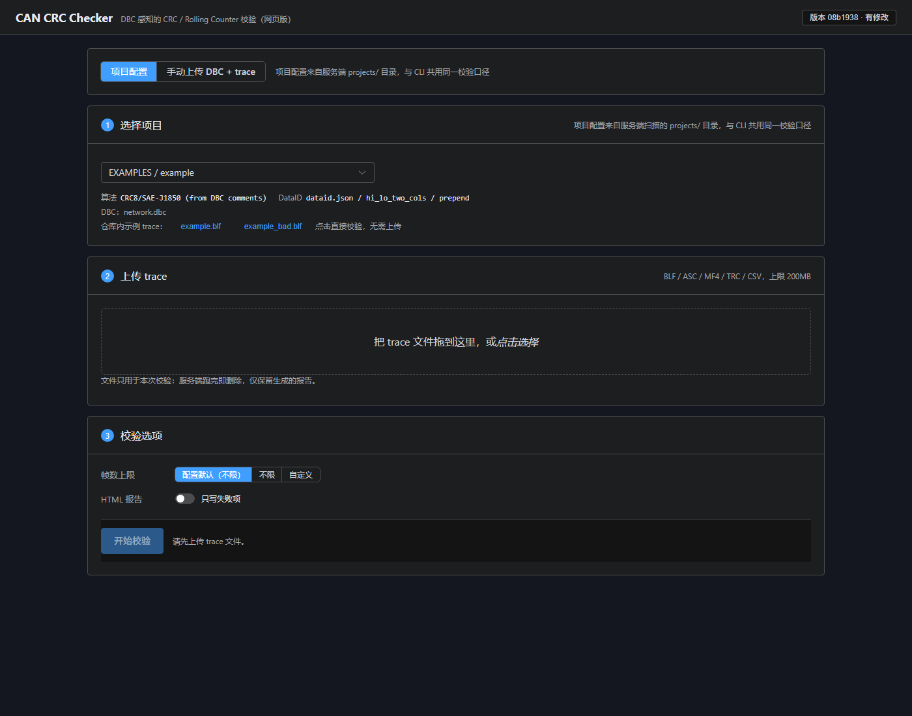
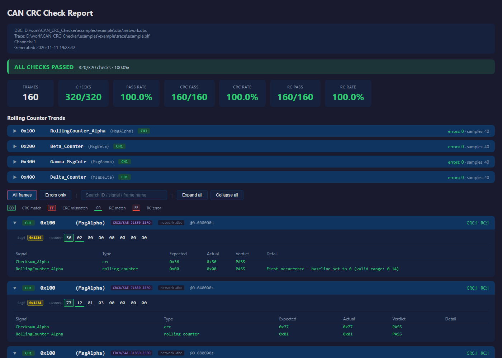

<div align="center">

# CAN CRC Checker

基于 DBC 的 CAN 总线 CRC / 滚动计数器校验工具，支持 BLF、ASC、MF4、TRC trace。

[](https://opensource.org/licenses/MIT)
[](https://www.python.org/)
[](https://github.com/zhaojiale2021/CAN_CRC_Checker/actions/workflows/ci.yml)

[English](../../README.md) | [🌍 中文](./README.md)

</div>

---

| 网页版 | 自包含 HTML 报告 |
| --- | --- |
|  |  |

---

给它一个 DBC 和一份 trace：它按信号名找出校验和与滚动计数器，用配置的算法计算期望值，
逐帧对比并生成自包含的 HTML 报告。没有车型相关的硬编码 —— 信号名匹配规则和 DataID
表格布局都是配置文件。

本仓库**只包含合成示例数据**。

## 🚀 30 秒上手

```bash
git clone https://github.com/zhaojiale2021/CAN_CRC_Checker.git
cd CAN_CRC_Checker
pip install -r requirements.txt

# 跑自带示例（CLI；无需打包，也没有 .exe）
python -m cli.main run -c examples/example/config.json -v

# 可选：安装 crc-check 命令
pip install -e .
crc-check run -c examples/example/config.json -v
crc-check presets
crc-check inspect examples/example/dbc/network.dbc
```

预期结果：160 帧、320 项校验、100% 通过。

```bash
# 故意出错的示例 → 失败明细 + RC 错误趋势
python -m cli.main run -c examples/example/config_bad.json -v
```

作为 CI 门禁：`--fail-on-failure` 有任何失败就退出 1，`--min-pass-rate 99.5`
低于阈值退出 1（`crc-check verify` 同样支持）。

```bash
crc-check run -c examples/example/config.json --fail-on-failure
```

MF4/MDF 需要 python-can 的可选 reader；`requirements.txt` 已包含。若只执行
`pip install -e .`，请补 `pip install "python-can[mf4]"`（或
`pip install -e ".[mf4]"`）。

## 🌐 网页版

```bash
./run_web.sh 8000          # Windows: run_web.bat 8000
# 浏览器打开 http://127.0.0.1:8000
```

两种用法：选择**项目 id**，或切到**手动模式**上传 DBC + trace（可选 DataID 文件），
再在页面上填写算法、CRC 范围、DataID 布局、帧过滤等配置。项目详情里的示例 trace
可以直接点选校验，不需要先下载再上传。浏览器只提交项目 id 或上传文件，路径始终在
服务端解析。项目从 `projects/` 扫描（不存在时用 `examples/`，可用
`CRC_CHECKER_PROJECTS_DIR` 覆盖）。Vue 前端产物 `frontend/dist` 已提交，部署机
无需 Node。启动脚本默认仅监听 `127.0.0.1`；可传入 host 参数或设置 `CRC_WEB_HOST`
显式开放局域网访问。网页版没有认证，网络暴露时必须放在带认证的反向代理或等效访问控制后。
详见 [docs/web-api.md](../web-api.md)。

## 🌟 能力一览

| 需求 | 工具提供 |
| --- | --- |
| **自动识别保护信号** | 前缀（`Checksum_*`、`CRC_*`）与后缀（`*_CRC`、`*_Counter`）、多 E2E 实例、传感器总线标记、BlockCounter 排除 —— 全部由 YAML 正则驱动 |
| **E2E Profile 校验** | Profile 5（CRC16/CCITT，DataID 追加，字节交换）与 Profile 1/1A（CRC8/SAE-J1850-ZERO，DataID 前置，4-bit 计数器） |
| **非 CRC 校验和** | SUM8、SUM8/XOR-FF、XOR8/SEED，可按 DBC 注释逐报文选择 |
| **多种 trace 格式** | BLF、ASC、MF4、TRC、CSV/LOG（MF4 需要 `python-can[mf4]`） |
| **大 trace** | 流式校验、CRC 引擎缓存、RC 趋势图抽稀、报告体积上限保护 |
| **CI 门禁** | `--fail-on-failure` / `--min-pass-rate`；帧上限截断一定会提示 |
| **DataID 表** | `.xlsx`、旧版 `.xls` 与预处理 JSON；列布局由 YAML 命名映射提供 |
| **结果可复现** | CLI 与网页版共用同一个 runner（`crc_checker/verify/runner.py`） |

## 🧮 支持的算法

“已用实际数据验证”指该算法在开发过程中用抓取的 CAN trace 复现出了期望值；
其余算法只做了单元测试与公开测试向量，**未用实际数据验证** ——
`crc-check presets` 会逐条显示同样的状态。

| 预设 | 用途 | 状态 |
| --- | --- | --- |
| `CRC16/CCITT` | AUTOSAR E2E Profile 5 | ✅ 已用实际数据验证 |
| `CRC8/SAE-J1850-ZERO` | AUTOSAR E2E Profile 1 / 1A | ✅ 已用实际数据验证 |
| `CRC8/SAE-J1850` | DBC 注释描述的校验和 | ✅ 已用实际数据验证 |
| `SUM8/XOR-FF` | 字节求和 `& 0xFF` 后再 `XOR 0xFF` | ✅ 已用实际数据验证 |
| `XOR8/SEED` | 带常量 seed 的逐字节异或 | ✅ 已用实际数据验证 |
| `SUM8` | 纯加和 `& 0xFF` | ✅ 已验证（更宽字段变体未验证） |
| `CRC8/AUTOSAR`、`CRC8/H2F`、`CRC16/ARC`、`CRC16/MODBUS`、`CRC32/AUTOSAR`、`CRC32/ETHERNET`、`XOR8` | — | ⚠️ 未用实际数据验证 |

详细说明与“转正”清单：[docs/supported-algorithms.md](../supported-algorithms.md)。

## 🧩 不改代码的扩展方式

**新增信号命名** —— 在
[`crc_checker/data/patterns.yaml`](../../crc_checker/data/patterns.yaml)
里加一条正则：

```yaml
checksum:
  prefix: ['(?i)^(checksum|check_sum|crc|e2e_crc)']
  suffix: ['(?i)(_crc|_checksum|_chks)([0-9_]*)$']
rolling_counter:
  prefix: ['(?i)^(rolling.?counter|rc_|alive.?counter)']
  suffix: ['(?i)(_counter|_cntr|_msgcntr)([0-9_]*)$']
  exclude: ['(?i)block_?counter']
```

也可以用 `signals.patterns_file` 指向自己的 YAML，或在 config 里用
`signals.checksum_patterns` / `signals.rc_patterns` 内联扩展。

**新增 DataID 表格布局** —— 在
[`crc_checker/data/dataid_mappings.yaml`](../../crc_checker/data/dataid_mappings.yaml)
里加一个命名映射，然后用 `dataid.mapping` 选中；独立文件用
`dataid.mapping_file`。内置名称：`hi_lo_two_cols`、`single_16bit`、`generic_abc`、
`simple_8bit`、`description_regex`。

**新增项目** —— 把 `config.json`（以及它引用的 DBC/DataID/trace）放进 `projects/`。

## ⚙️ 配置

每次校验由一个 JSON 配置文件描述（`crc-check gen-config` 会生成带注释的示例）。
主要字段：

| 段 | 字段 | 说明 |
| --- | --- | --- |
| 顶层 | `dbc` / `dbcs` | 单个 DBC 路径，或文件/目录列表 |
| | `dbc_merge` | 合并多个 DBC 为一个映射，而不是按通道选择 |
| `crc` | `preset` | 预设名；`custom` 表示内联参数 |
| | `byte_swap` | 比较前交换 CRC 字节（Profile 5） |
| | `auto_classify` | 按 DBC 注释逐报文选择算法 |
| | `profile_by_width` | 2 字节 CRC → Profile 5，1 字节 → Profile 1 |
| | `profiles` | 按 Profile 覆盖（算法、DataID 布局、范围、计数器上限） |
| | `range_overrides` / `skip` | 逐报文范围 / 不校验的信号 |
| `range` | `mode` | `exclude_crc` / `full_payload` / `custom_range` |
| | `start_byte` / `end_byte` | `custom_range` 的起止字节（`-1` = 帧尾） |
| `dataid` | `json` / `xlsx` | 预处理 JSON（快）或 Excel 源表 |
| | `mapping` / `mapping_file` | DataID 列布局 |
| | `position` / `byte_order` / `default` | `prepend`/`append`、`lo_hi`/`hi_lo`、未匹配时的默认 DataID |
| `signals` | `patterns_file` | 自定义信号名 YAML |
| | `checksum_pattern(s)` / `rc_pattern(s)` | 正则覆盖 |
| `filter` | `frame_ids` / `max_frames` | CAN ID 过滤；帧上限（`0` = 不限，默认 6000） |
| `rc` | `max_valid` | 计数器最大值（默认 `2^位数 - 1`） |
| `output` | `format` / `file` / `only_failures` | `table` 或 `html`、输出路径、只写失败项 |
| | `max_report_sections` | 报告帧段上限（默认 30000，0 = 不限） |

完整 schema 见 `crc_checker/config.py`（`CONFIG_SCHEMA_DOC`）。

## 📁 目录结构

```
crc_checker/            核心包
  crc/                  CRC 引擎、预设、E2E Profile、注释分类
  dbc/                  DBC 解析 + 信号解析
  dataid/               DataID Excel/JSON 解析
  trace/                trace 读取（BLF/ASC/MF4/TRC/CSV）
  protect/              CRC 与滚动计数器校验器
  verify/               校验编排（CLI 与网页版共用）
  report/               自包含 HTML 报告 + RC 趋势图
  data/                 随包发布的 patterns / DataID 映射默认值
cli/                    Click CLI（python -m cli.main）
webapp/                 FastAPI 后端
frontend/               Vue 3 + Element Plus（dist 已入库）
examples/               合成示例项目与生成脚本
tests/                  pytest 测试
```

## 🧪 开发

```bash
pytest --tb=short --cov=crc_checker --cov=cli --cov=webapp \
  --cov-report=term --cov-fail-under=80          # CI 后端测试命令
pylint $(git ls-files '*.py')                     # 必须 10.00/10
cd frontend && npm run lint                       # eslint + prettier 检查
cd frontend && npm test                           # node --test(纯逻辑单测)
cd frontend && npm run test:component             # vitest 组件冒烟测试
cd frontend && npm install && npm run build       # 重新构建 dist
python examples/generate_example.py               # 重新生成示例
```

CI 在 Python 3.9、3.11、3.13 上运行 pylint 与带覆盖率门槛的 pytest，另有一个
Windows pytest 作业，以及前端 lint、单测、组件测试和 `frontend/dist`
新鲜度检查。pre-push 钩子会运行 pylint 和同样要求 80% 覆盖率的后端 pytest；
安装了 `uv` 时使用 Python 3.11，否则使用当前 Python 环境。钩子不替代完整 CI
矩阵或前端检查。

## 🤝 贡献

欢迎提 issue / PR。提交前请运行上面的开发检查；CI 还会覆盖 Python 矩阵、Windows、
前端检查和已提交 `dist` 的新鲜度。

## 📄 许可证

MIT。见 [LICENSE](../../LICENSE)。

---

<div align="center">

**DBC 进去，trace 进去，结论出来 —— 没有客户专用代码路径。**

[⭐ Star](https://github.com/zhaojiale2021/CAN_CRC_Checker) · [🐛 反馈问题](https://github.com/zhaojiale2021/CAN_CRC_Checker/issues)

</div>
